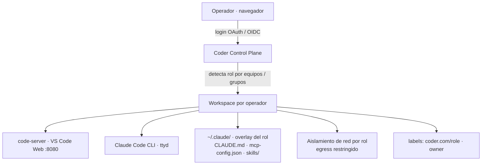
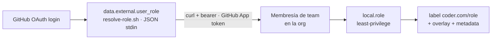
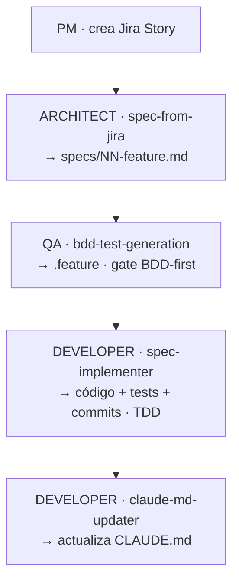

# Manual Técnico — Plataforma Coder + Claude Code por Rol

**Para:** Ingeniería / Arquitectura / DevSecOps
**De:** Equipo DevSecOps — Qintess
**Estado:** Piloto validado E2E · Documento TO-BE

Resumen del **despliegue real del piloto** (una VM con Docker en `Qintess-Latam`) y referencia técnica completa del
diseño objetivo de producción (K8s + IdP corporativo).

---

## Índice

**Despliegue del piloto (VM + Docker)**
- [00 · Qué es y qué obtienes](#00--qué-es-y-qué-obtienes)
- [01 · Pre-requisitos](#01--pre-requisitos)
- [02 · Servicios de la VM](#02--servicios-de-la-vm)
- [03 · GitHub: OAuth App + GitHub Apps](#03--github-oauth-app-login--github-apps)
- [04 · Configurar el server](#04--configurar-y-lanzar-el-server)
- [05 · Plantillas por rol + overlays](#05--publicar-las-plantillas-por-rol--overlays)
- [06 · Crear workspace y entrar](#06--crear-workspace-y-entrar)
- [07 · Persistencia (sobrevive reboot)](#07--persistencia--sobrevive-al-reboot)
- [08 · Recuperación](#08--recuperación)
- [09 · Cambiar de org / cliente](#09--cambiar-de-org--cliente)
- [10 · Backend LLM](#10--backend-llm-intercambiable)

**TO-BE técnico (diseño objetivo de producción)**
- [11 · Arquitectura de referencia](#11--arquitectura-de-referencia-producción)
- [12 · Registro de decisiones](#12--registro-de-decisiones)
- [13 · RBAC y resolución de rol](#13--rbac-y-resolución-de-rol)
- [14 · Matriz de permisos](#14--matriz-de-permisos-por-rol)
- [15 · Template Terraform](#15--template-terraform-base--overlay)
- [16 · Skills y flujo BDD](#16--skills-y-flujo-spec-como-contrato-único)
- [17 · MCP y secretos](#17--mcp-y-gestión-de-secretos)
- [18 · Aislamiento de red](#18--aislamiento-de-red-producción)
- [19 · Imagen base](#19--imagen-base)
- [20 · Observabilidad y audit](#20--observabilidad-y-auditoría)
- [21 · AuthZ a escala](#21--authz-a-escala-piloto--miles)
- [22 · Deployment producción](#22--deployment-producción-k8s)
- [23 · Riesgos y mitigaciones](#23--riesgos-y-mitigaciones)
- [24 · Estado del piloto](#24--estado-del-piloto-validado-e2e)

---

## 00 · Qué es y qué obtienes

Cada operador entra con su cuenta corporativa y recibe, en el navegador, un entorno completo (VS Code + terminal +
Claude Code + GitHub Copilot CLI) **configurado según su rol** — con las skills, integraciones (MCP), reglas de trabajo,
binarios y accesos propios de Architecture (PM/PO), Developer, Platform, QA o Cyber. Sin instalar nada en local.


*Fig. 1 — Flujo de un login a un workspace gobernado por rol*

Este manual distingue dos planos: **AS-IS del piloto** (lo que ya funciona en una VM de `Qintess-Latam` sobre
Docker — secciones 01–10) y **TO-BE de producción** (el diseño objetivo sobre Kubernetes — secciones 11–24). La ruta
piloto→producción es de **escala e infraestructura, no de rediseño**.

> **Estado (2026-10-15).** Esta parte resume el despliegue real; el paso a paso exacto (con gotchas y salidas
> esperadas) vive en los runbooks enlazados en cada sección.

---

# Parte A · Despliegue del piloto (VM + Docker)

## 01 · Pre-requisitos

Todo corre en **una VM Ubuntu** con Docker. Coder va en el `$HOME` (sin sudo); el resto en contenedores
orquestados por Portainer.

| Componente | Versión | Para qué |
|---|---|---|
| **Docker Engine** | 20+ | Contenedores de workspace + stacks (Caddy, PostgreSQL, Backstage, Portainer) |
| **Coder** (standalone) | v2.37.4 | Control plane, `~/.local/bin/coder`, servicio `systemd --user` |
| **Terraform** | el del provisioner | El código de las plantillas no usa módulos del registry |
| **gh** CLI | 2.x | Teams, GitHub App, seats de Copilot |
| **Org de GitHub** | `Qintess-Latam` | Login (OAuth), teams de rol, GitHub Apps, Copilot Business |

Instalación mecánica de la VM: `deploy/vm/bootstrap-vm.sh` (binarios, `start-server.sh`, units de systemd) →
[`RUNBOOK-vm-deploy.md`](RUNBOOK-vm-deploy.md).

> Node, ttyd, code-server, Claude Code, Copilot CLI, uv y los binarios de cada rol **no se instalan en el host**:
> los instala el `startup_script` dentro del workspace, de forma idempotente.

## 02 · Servicios de la VM

| Servicio | Cómo corre | Puerto |
|---|---|---|
| Coder server | `systemd --user` `coder.service` (linger) | `127.0.0.1:3001` |
| Caddy (HTTPS, `tls internal`) | stack `caddy` en Portainer, `network_mode: host` | `:3000` Coder · `:7007` Backstage · `:9443` Portainer |
| PostgreSQL de Coder | stack `coder-db` (`postgres:17-alpine`) | `127.0.0.1:5432` |
| Backstage "Symphony" | stack `backstage` | `127.0.0.1:7008` |
| Portainer | `docker compose` (no se gestiona a sí mismo) | `127.0.0.1:9000` |

Timers (`systemd --user`): `coder-db-backup` (diario 03:00), `caddy-lan-ip` (cada minuto), `copilot-spend` (cada
hora). La CA de Caddy está en el trust store del host (el healthcheck de Coder se autoconsulta por HTTPS).

Detalle: [`RUNBOOK-vm-portainer-red.md`](RUNBOOK-vm-portainer-red.md), [`RUNBOOK-https-caddy.md`](RUNBOOK-https-caddy.md).

## 03 · GitHub: OAuth App (login) + GitHub Apps

Son credenciales **distintas** — no confundir:

| Credencial | Para qué | Permisos |
|---|---|---|
| **OAuth App de login** de Coder | AuthN + external-auth `github` (token del usuario) | — (callback en `CODER_ACCESS_URL`) |
| **GitHub App `qintess-latam-rbac-resolver`** | AuthZ: `resolve-role.sh` consulta membresía de teams | Organization → Members: read |
| **GitHub App `qintess-mozart-bot`** | Backstage/mozart (repos) y lectura de billing de Copilot | administration, contents, members… |
| **OAuth App Atlassian** | external-auth `atlassian` (Jira/Confluence por usuario) | 3LO |

Los `.pem` son el **único** secreto de cada App: perm `600`, fuera de git.

**Teams de rol** (`Qintess-Latam`): `qintess-architect`, `qintess-developers`, `qintess-platform`, `qintess-qa`,
`qintess-cyber`, cada uno con sub-teams `-senior-dev`, `-repo-admin`, `-release-eng`, `-appsec` que también otorgan el
rol del padre.

Paso a paso: [`RUNBOOK-vm-qintess-latam.md`](RUNBOOK-vm-qintess-latam.md) (Fase 2), [`RUNBOOK-github-app.md`](RUNBOOK-github-app.md).

## 04 · Configurar y lanzar el server

Toda la configuración sensible vive en `~/.config/coderv2/server.env` (perm `600`, **nunca** a git); el servicio la
carga vía `start-server.sh`.

```bash
# ~/.config/coderv2/server.env (extracto)
export CODER_HTTP_ADDRESS=127.0.0.1:3001                    # detrás de Caddy
export CODER_ACCESS_URL=https://201.203.104.168:3000
export CODER_PG_CONNECTION_URL="postgres://coder:…@127.0.0.1:5432/coder?sslmode=disable"
export CODER_OAUTH2_GITHUB_CLIENT_ID=…  CODER_OAUTH2_GITHUB_CLIENT_SECRET=…
export CODER_OAUTH2_GITHUB_ALLOWED_ORGS=Qintess-Latam  CODER_OAUTH2_GITHUB_ALLOW_SIGNUPS=true
export GITHUB_APP_ID=…  GITHUB_APP_INSTALLATION_ID=…  GITHUB_APP_PRIVATE_KEY_PATH=~/.config/coderv2/github-app.pem
export CODER_EXTERNAL_AUTH_0_ID=github     # reusa la OAuth App de login
export CODER_EXTERNAL_AUTH_1_ID=atlassian  # OAuth App de Atlassian
```

```bash
systemctl --user restart coder.service
curl -s https://201.203.104.168:3000/healthz        # OK (sin -k: la CA de Caddy está en el host)
```

> **Gotcha · callback:** la OAuth App acepta **un solo** callback: debe coincidir con `CODER_ACCESS_URL`. Cambiar de
> IP/dominio = actualizar el callback **antes** de reiniciar Coder.

## 05 · Publicar las plantillas por rol + overlays

Un solo código (`templates/mvp-embedded/`) → **cinco plantillas**, una por rol, cambiando `template_role`:

```bash
bash deploy/vm/sync-agent-overlays.sh      # overlays + skills (repos de la org) → agents-overlays-synced
bash deploy/vm/push-role-templates.sh      # qintess-{architecture,developer,platform,qa,cyber}-template
```

| Overlay (repo `qintess-platform-agents-overlays`) | Destino en el workspace |
|---|---|
| `CLAUDE.md` | `~/.claude/CLAUDE.md` y `~/.copilot/copilot-instructions.md` |
| `skills/` (repo `-skills`) | `~/.claude/skills/` y `~/.copilot/skills/` |
| `mcp-config.json` | `~/workspace/.mcp.json` y `~/.copilot/mcp-config.json` |
| `settings.json` (modelo + permisos) | mezclado en `~/.claude/settings.json` |

> **Gotcha · push obligatorio:** editar el template **no surte efecto** hasta subirlo; Coder corre la versión
> **subida**. Tras un push los workspaces quedan `OUTDATED` hasta su próximo arranque.

Detalle: [`RUNBOOK-plantillas-por-rol.md`](RUNBOOK-plantillas-por-rol.md).

## 06 · Crear workspace y entrar

1. **Entrar** en `https://201.203.104.168:3000` → **Sign in with GitHub** (miembro de `Qintess-Latam`).
2. **Crear el workspace con la plantilla de su rol.** Si el usuario no está en el team del rol, el build falla con
   un mensaje claro (`resolve-role.sh`). El `startup_script` instala code-server (+ extensión de Claude), Claude Code,
   Copilot CLI, Node 20, uv, aplica el overlay del rol y, al final, los binarios del rol.
3. **Conectar integraciones (1 clic)** — GitHub y Atlassian vía external-auth. Los MCP actúan con **su** identidad.
4. **Claude:** `/login` una vez (credencial en su home persistente). **Copilot:** con su seat (por team).

El panel del workspace muestra rol, versiones, estado de GitHub/Atlassian, herramientas del rol y
*Estimated AI spend/month*.

## 07 · Persistencia — sobrevive al reboot

| Pieza | Cómo persiste |
|---|---|
| **Datos** (`/home/coder`) | Volumen Docker `coder-<id>-home` |
| **Coder server** | `coder.service` (enabled + **linger**) |
| **BD** | volumen `coder-db-data` + backups diarios verificados (14 días + domingos 8 semanas) |
| **Contenedores** | `restart = "unless-stopped"` → Docker revive el mismo contenedor |
| **Stacks** | Portainer (`restart: unless-stopped`) |

## 08 · Recuperación

```bash
systemctl --user status coder.service || systemctl --user restart coder.service
coder list -a                                   # HEALTHY=true
coder restart <owner>/<ws> --yes                # recrea el contenedor y re-resuelve rol + overlay
```

> **restart vs update:** `restart` crea un build nuevo (re-resuelve rol + overlay); `update` solo aplica si la
> plantilla está `OUTDATED`. Un reboot con `unless-stopped` revive el **mismo** contenedor y **no** re-resuelve.

Restaurar la BD desde un backup y cambios de IP de la VM: [`RUNBOOK-vm-portainer-red.md`](RUNBOOK-vm-portainer-red.md).

## 09 · Cambiar de org / cliente

1. Crear en la org nueva: OAuth App de login, GitHub App de resolución de rol, teams de rol, OAuth App de Atlassian.
2. Actualizar `server.env` (client id/secret, `CODER_OAUTH2_GITHUB_ALLOWED_ORGS`, `GITHUB_APP_*`) y reiniciar Coder.
3. Cambiar `github_org` en `deploy/vm/push-role-templates.sh` y en `sync-agent-overlays.sh` (`ORG`) y volver a subir.

## 10 · Backend LLM (intercambiable)

El selector `local.llm_env` elige el backend con precedencia **vertex > bedrock > subscription > api_key** y setea
solo las variables de ese backend. **Hoy:** `subscription` sin token en la plantilla → cada usuario hace `/login`.
Token compartido, API key o Vertex/Bedrock se pasan como variables de entorno a `push-role-templates.sh`:
[`RUNBOOK-llm-backend.md`](RUNBOOK-llm-backend.md).

---

# Parte B · TO-BE técnico

## 11 · Arquitectura de referencia (producción)

Coder que: (1) autentica vía OAuth/OIDC; (2) resuelve el rol por pertenencia a equipos/grupos; (3) provisiona un
workspace con el overlay del rol; (4) expone code-server + Claude Code CLI; (5) aplica NetworkPolicies por rol;
(6) registra audit trail completo.

**Enfoque elegido — Decisión #10**

| Enfoque | Veredicto | Razón |
|---|---|---|
| **A** · Coder nativo + CLAUDE.md por rol | ✅ elegido | Mínimo código custom; Coder maneja el lifecycle. Overlay estático (rol build-time) |
| **B** · Sidecar de governance dinámico | ❌ | Complejidad, latencia y superficie de ataque |
| **C** · Orchestrator centralizado | ❌ | SPOF y latencia |

## 12 · Registro de decisiones

| # | Decisión | Elección |
|---|---|---|
| 1 | Cloud provider | Agnostic (implementar en uno) |
| 2 | Identity Provider | GitHub OAuth (piloto) → OIDC corporativo (prod) |
| 3 | Rol mapping | GitHub Teams / grupos IdP → Coder roles |
| 4 | Roles | Architect + Developer + QA (3) |
| 5 | LLM | Claude ahora, diseño model-agnostic |
| 6 | Interfaz | code-server + Claude Code CLI |
| 7 | Template strategy | Híbrido: base + overlay por rol |
| 8 | Network isolation | Egress restringido por rol |
| 10 | Enfoque arquitectónico | A — Coder nativo + overlay |
| 11 | Secretos MCP | Per-user vía OAuth (external-auth) + ESO |
| 12 | Jira auth | OAuth 2.0 3LO (1 clic por usuario, rotación auto) |
| 17 | Credencial AuthZ del server | **GitHub App** de la org (installation token auto-rotado) |
| 18 | Cambios de rol | Build-time asimétrico: promoción en rebuild; degradación/offboarding inmediato |

> Decisiones #13–16 en `docs/TO-BE/00-desiciones.md`.

## 13 · RBAC y resolución de rol

**Normas**

| Norma | Regla |
|---|---|
| **One-role-per-user** | Cada persona en un solo team de rol; multi-team es excepción |
| **Least-privilege** | En multi-team gana el rol **menos permisivo**: `qa < developer < architect` |
| **Fail-closed** | Sin team válido → `unknown` (mínimos privilegios), nunca un rol por defecto |

**Mecánica (piloto, validado)**


*Fig. 2 — Resolución de rol en tiempo de build*

`resolve-role.sh` lee **JSON por stdin** (`{github_username, github_org, required_role}`), consulta la membresía
vía **curl + bearer** (en el provisioner `gh` no está en PATH). Con las **plantillas por rol** (`required_role` =
rol de la plantilla) solo deja crear el workspace si el usuario está en el team de ese rol (o un sub-team); si no,
el build falla con un mensaje claro — es el control de acceso que Coder OSS no tiene. En la plantilla genérica
(sin `required_role`) aplica la prioridad least-privilege. Precedencia de credencial: **PAT env > GitHub App > gh
ambiente**.

**Aplicación de cambios — Decisión #18**

| Cambio | Riesgo | Aplicación |
|---|---|---|
| Promoción (qa→architect) | Bajo | Próximo rebuild natural |
| Degradación / offboarding | Alto | **Inmediato, fail-closed**: `coder stop`/`delete` (no relabel en caliente) |

## 14 · Matriz de permisos por rol

| Recurso | Architecture (PM/PO) | Developer | Platform | QA | Cyber |
|---|---|---|---|---|---|
| **Skills** | spec-from-jira, architecture-review | spec-implementer, claude-md-updater, code-review-security, frontend/UX | — (por definir) | bdd-test-generation, coverage-gap, unit-test, mutation | — (por definir) |
| **Binarios** | pandoc, PlantUML, Mermaid, yq | Java 21 + Maven, .NET, Python + uv | Terraform, kubectl, Helm, AWS/Azure CLI | Playwright, k6, Newman, Allure | Trivy, Gitleaks, Semgrep, ZAP |
| **MCP** | GitHub, Atlassian | GitHub, Atlassian | GitHub, Atlassian | GitHub, Atlassian, Playwright | GitHub, Atlassian |
| **Modelo por defecto** | Opus | Sonnet | Sonnet | Sonnet | Sonnet |
| **Permisos clave** | sin apply/deploy | `.tf`/helm/k8s en *ask* | plan/lint/diff sí; apply/destroy/install en *deny* | `src/` en *deny* | escaneo estático sí; `zap`/`curl` en *ask*; nmap/sqlmap en *deny* |
| **Egress (TO-BE)** | github, anthropic, atlassian | + npm, pypi, docker | + APIs de cloud | + selenium-grid | + feeds de vulnerabilidades |
| **Governance** | Spec completo | BDD-first, 15 files/500 líneas, single-story | plan antes de apply, prod vía pipeline | Coverage ≥80%, sin PII | autorización previa para DAST |

## 15 · Template Terraform (base + overlay)

```
templates/
├── mvp-embedded/        # PILOTO (Docker, sin módulos) — código de las 5 plantillas por rol
│   ├── main.tf          # docker_container + coder_agent + coder_app + rol + overlay + panel
│   └── scripts/         # resolve-role.sh · role-tools.sh · ai-spend.mjs · gh-app-token*.sh
└── prod-oidc/           # PRODUCCIÓN (K8s, rol nativo por grupo OIDC) — referencia
# overlays y skills: repos qintess-platform-agents-overlays / -skills
#   <rol>/{CLAUDE.md · mcp-config.json · settings.json} + skills/<rol>/
```

| Plano | Cómo entrega el overlay |
|---|---|
| **Piloto** (plantillas por rol) | `docker_container` con `restart="unless-stopped"`; overlay por **bind-mount** (`/opt/overlays` RO, sincronizado desde los repos) → copiado a `~/.claude/` y `~/.copilot/` en startup |
| **Producción** (prod-oidc) | `kubernetes_pod` + overlay vía **ConfigMap** (`overlay-<role>`) RO; `kubernetes_network_policy` de egress por rol |

## 16 · Skills y flujo (spec como contrato único)

Un único spec sirve a los roles de producto (Architecture, QA, Developer); cada uno lee sus secciones. Patrón **BDD-first** con el `.feature` como contrato
inmutable.


*Fig. 3 — El spec como contrato único entre los roles de producto*

## 17 · MCP y gestión de secretos

**Principio:** separar la credencial de **plataforma** (AuthZ del server) de la credencial **por usuario** (acceso a
sus recursos).

| Server | Paquete | Auth | Estado |
|---|---|---|---|
| github | `@mcp/server-github` | external-auth OAuth per-usuario → solo sus repos | ✅ |
| atlassian | `uvx mcp-atlassian` | OAuth 3LO per-usuario (cloud_id autodetectado) | ✅ |
| playwright | `@playwright/mcp` | browser local (Node 20 + chromium) | ✅ |
| sonarcloud | — | — | ⏳ sin cuenta (retirado de los overlays) |

> **Tres credenciales GitHub — no confundir:** (1) **OAuth App** = login Coder (AuthN). (2) **GitHub App**
> `qintess-latam-rbac-resolver` = resolver rol (AuthZ, solo `Members:read`, token auto-rotado ~1h). (3) **external-auth
> OAuth** = token del usuario para su git/GitHub MCP.

**Aislamiento per-usuario demostrado E2E:** mismo template, usuario A ve 90 repos, usuario B ve 0 — el acceso lo
aplica GitHub según la identidad del token, no la plataforma.

> **Gotcha · el token de Atlassian expira en ~1h (Jira MCP daba 401):** hay **dos capas**. (1) Coder↔Atlassian:
> el usuario hace *Login* una vez y Coder **auto-refresca** el access token (por `offline_access`) — en la UI
> *External Authentication* aparece "conectado" siempre. (2) Coder→workspace: si el token se **hornea** en el env
> en tiempo de build (`ATLASSIAN_OAUTH_ACCESS_TOKEN = data.coder_external_auth.atlassian.access_token`), esa
> variable es una **foto** que caduca a la hora; un workspace que lleve >1h corriendo sirve un token muerto → **401**,
> aunque la UI diga "conectado". **Fix aplicado:** el MCP de Atlassian ya **no** usa la foto — pide el token
> **fresco a Coder en cada arranque** con `coder external-auth access-token atlassian` (wrapper `bash -lc` en
> `<rol>/mcp-config.json` del repo de overlays) y deriva el `cloud_id` en ese momento. El binario `coder` del workspace vive en
> `/tmp/coder.*/coder` y el proceso MCP hereda `CODER_AGENT_TOKEN`/`CODER_AGENT_URL` del agente (por eso funciona
> en el MCP pero NO con `docker exec`, que no hereda ese env). Límite conocido: `mcp-atlassian` en modo BYOT no
> auto-refresca dentro de una misma sesión — una sesión de Claude abierta >1h puede requerir reconectar el MCP.

> **Gotcha · usuarios nuevos no pueden hacer "Login with Atlassian" ("app in development"):** la OAuth App de
> Atlassian arranca en modo **Development** en `developer.atlassian.com` → **solo el dueño** puede autorizarla; el
> resto ve *"You don't have access to this app… only the owner may grant it access."*. Invitar al usuario a Jira/al
> team da acceso a los **datos**, pero NO habilita autorizar la app. **Fix:** en `developer.atlassian.com` → la app
> → pestaña **Distribution** → cambiar de *Development* a **Sharing/Distributed** (pide privacy policy URL). Recién
> ahí cualquier usuario puede conectar Atlassian con su cuenta. (Aplica solo a la app de Atlassian; el login a
> Coder por GitHub OAuth no tiene esta restricción.)

## 18 · Aislamiento de red (producción)

| Control | Detalle |
|---|---|
| **CNI** | Cilium — egress filtering por **FQDN** (no IPs estáticas) |
| **Default deny** | + inter-pod blocked (dev↔qa aislados) + ingress solo desde el control plane + DNS restringido a kube-dns |
| **Egress por rol** | todos → github, anthropic; developer → + npm, pypi, docker; qa → + atlassian, selenium-grid |

> **Nota · piloto:** el aislamiento por Cilium es del plano de producción. El piloto (Docker, 1 host) usa
> aislamiento por identidad de token + separación de contenedores.

## 19 · Imagen base

- Ubuntu 24.04, multi-stage (~450 MB): code-server, Claude Code CLI, git, gh, Node.js, Python 3, Docker CLI.
- Non-root (`coder`, UID 1000). `HEALTHCHECK` sobre `:8080/healthz`.
- CI/CD: GitHub Actions → `ghcr.io/qintess/coder-workspace:latest`. Rebuild mensual.

> **Gotcha documentado:** el node embebido de code-server puede quedar en 0 bytes → guard endurecido en el
> `startup_script` (`code-server --version` + `test -s .../lib/node` + `curl --retry`).

## 20 · Observabilidad y auditoría

Cuatro capas: **Coder Audit** (logins, lifecycle), **Claude usage** (tokens, tool/MCP calls), **K8s metrics**
(CPU/RAM, egress, denies), **Governance events** (gate violations, blocked egress).

| Aspecto | Detalle |
|---|---|
| **Stack** | Prometheus + Grafana + Loki; audit trail en PostgreSQL |
| **Retención** | login/workspace 1 año · Claude sessions 90 días · governance 1 año · net denies 30 días |
| **KPIs** | `governance_gate_violations → 0`, tokens/user/día < budget, workspace_cost_usd/user/día |

## 21 · AuthZ a escala (piloto → miles)

Separación estricta **AuthN** (SSO, escala sola — el usuario nunca pega un token) vs **AuthZ** (rol, resuelto por
**una** credencial de servidor para todos).

| Nivel | Credencial AuthZ | Rotación | Cuándo |
|---|---|---|---|
| 0 · PAT personal | PAT en server.env | Manual | Prototipo inicial (superado) |
| 1 · Bot + fine-grained PAT | PAT read:org de bot | Anual | Piloto/squad |
| **2 · GitHub App** ✅ | Installation token (JWT→~1h) | **Auto ~1h** | **Producción con GitHub (elegido)** |
| 3 · IdP + group sync | Ninguna custom (claims IdP) | N/A | Banco/miles (futuro) |

## 22 · Deployment producción (K8s)

**Pre-requisitos:** K8s v1.28+ con Cilium · Helm v3 · GitHub Org con Teams (u OIDC) · DNS+TLS (cert-manager) · PVC
para workspaces · External Secrets Operator.

```bash
helm install coder coder-v2/coder -n coder --values values.yaml
coder templates push workspace-rbac --directory ./coder-templates/ --yes
kubectl create configmap overlay-developer \
  --from-file=overlays/developer/ -n coder-workspaces
# ... overlay-qa, overlay-architect
```

**Day-2:** imagen mensual · rotar secrets 90 días · autoscaler · backup PostgreSQL diario · audit review semanal ·
auto-stop 2h idle.

## 23 · Riesgos y mitigaciones

| Riesgo | Impacto | Mitigación |
|---|---|---|
| IdP/OAuth caído | No login | Admin local de emergencia |
| Quota/costo Claude | IA degradada | Budget alerts + graceful degradation + auto-stop |
| Overlay desactualizado | Permisos incorrectos | Rebuild de ConfigMaps en merge a main (CI/CD) |
| Misconfiguración Cilium | Egress leak | Integration tests + auditoría periódica |
| Rol residual tras baja | Hallazgo de auditoría | Decisión #18: offboarding = stop/delete inmediato + reconciliador/webhook |

## 24 · Estado del piloto (validado E2E)

| Capacidad | Estado |
|---|---|
| Coder v2.37.4 en VM + PostgreSQL en Docker + backups diarios | ✅ |
| HTTPS (Caddy) y acceso público por IP `201.203.104.168` | ✅ (falta dominio + cert real) |
| Login GitHub OAuth (`Qintess-Latam`) | ✅ |
| 5 plantillas por rol con binarios propios y control por team | ✅ (2026-10-15) |
| RBAC por teams + sub-teams, GitHub App para AuthZ | ✅ |
| Overlays por rol para Claude **y** Copilot (persona, skills, MCP, permisos) | ✅ 5 roles |
| MCP GitHub / Atlassian / Playwright per-usuario | ✅ (también en Copilot CLI) |
| Copilot Business: seats por team, modelos Claude, CLI y MCP habilitados | ✅ |
| Panel del workspace + *Estimated AI spend/month* | ✅ |
| Persistencia tras reboot (systemd + `unless-stopped`) | ✅ |
| Portainer orquestando Caddy, BD y Backstage | ✅ |
| Backend LLM | ✅ login por usuario (`/login`); Vertex/Bedrock sin decidir |
| prod-oidc (IdP corporativo) | 🟨 referencia, sin mantenimiento |
| Kubernetes, network isolation, secretos por usuario | ⏸️ diferido por decisión |
| SonarCloud | ⏳ sin cuenta (el rol cyber escanea con semgrep/gitleaks/trivy) |

---

### Anexo — Documentos fuente

Diseño en `docs/TO-BE/`: `00-desiciones` · `01-arquitectura-general` · `02-rbac-mapping-roles` ·
`03-template-terraform` · `04-skills-mcp-por-rol` · `05-network-isolation` · `06-imagen-base-docker` ·
`07-observabilidad-audit` · `08-deployment-operacion` · `09-gestion-secretos` · `10-jira-oauth-automatico` ·
`11-analisis-para-crear-specs` · `12-roles-y-skilles` · `13-authz-a-escala` · `SPEC-coder-claude-rbac-platform`.
Runbooks: `RUNBOOK-vm-deploy` · `RUNBOOK-vm-qintess-latam` · `RUNBOOK-plantillas-por-rol` · `RUNBOOK-vm-portainer-red` ·
`RUNBOOK-https-caddy` · `RUNBOOK-github-app` · `RUNBOOK-llm-backend` · `RUNBOOK-prod-oidc` · `rbac-setup` ·
`external-auth-oauth-pattern`.
